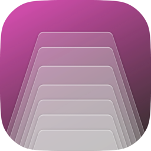
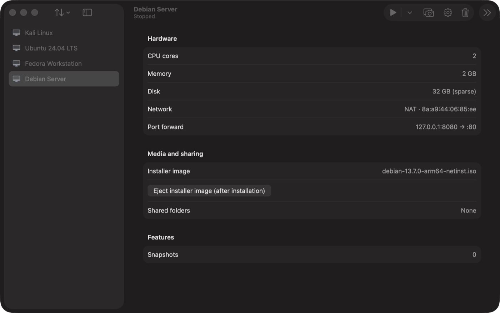
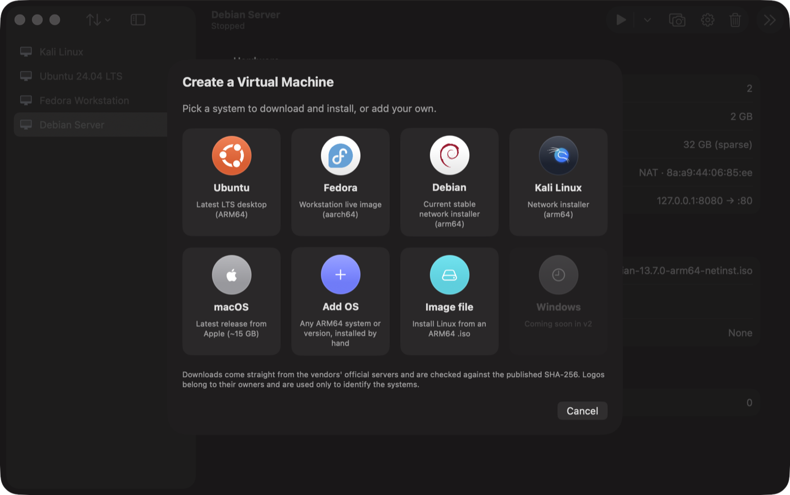
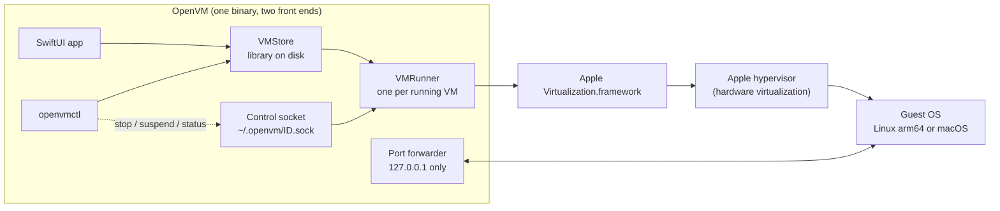

<div align="center">



# OpenVM

**A free, open-source virtual machine manager for Apple Silicon Macs.**<br>
Native SwiftUI app. Built only on Apple's public Virtualization framework. No telemetry, no accounts, no dependencies.

[](LICENSE)




</div>

---

## Contents

[Why OpenVM](#why-openvm) · [Features](#features) · [Install](#install) · [Command line](#command-line) · [How it works](#how-it-works) · [Your data and privacy](#your-data-and-privacy) · [Security](#security) · [Administrator policy](#administrator-policy) · [Technology](#technology) · [Limits](#limits) · [Status and roadmap](#status-and-roadmap) · [FAQ](#faq) · [License](#license)

## Why OpenVM

- **Free and open, forever.** GPL-3.0-or-later: you may use, study, change and share it, and every distributed derivative must stay free and open under the same license.
- **Native.** SwiftUI on Apple's own hypervisor stack. A 5 MB app, no bundled emulator, no kernel extensions, nothing running in the background.
- **Private.** No account, no analytics, no update pinging, no phoning home. The only network traffic is the installer downloads you ask for.
- **Scriptable.** Every action has a command (`openvmctl`) with JSON output, for CI pipelines and automation.
- **Careful with your data.** Disks are copy-on-write, snapshots are instant, and anything you import from someone else is treated as hostile until sanitized.

## Features

<div align="center">

</div>

### Create a machine in a few clicks

| | |
|---|---|
| **Ready-made systems** | Ubuntu (latest LTS), Fedora Workstation, Debian (stable netinstall), Kali Linux. OpenVM finds the current official ARM64 image at the moment you click, downloads it, and verifies its SHA-256 before use. Nothing is hard-coded to a release that can go stale. |
| **macOS guests** | Downloads Apple's latest supported restore image and installs it into a new VM. Apple's license allows two macOS VMs per Mac. |
| **Your own image** | Any ARM64 `.iso` installed by hand. |
| **+ Add OS** | Add any ARM64 system or version to the gallery: name, version note, color, your own picture, default CPU/RAM/disk, and either a local `.iso` or an `https://` download link with its SHA-256. Your entries become tiles you can reuse. |
| **Official logos** | The gallery shows each vendor's own logo. |

### Run

- **Suspend and resume.** Saves the exact machine state to disk and brings it back later.
- **Full screen.** Optional "start in full screen" per VM; the sidebar hides, the toolbar stays.
- **Headless.** `openvmctl run` starts a VM with no window and prints the serial console on the terminal.
- **Quit protection.** Quitting with running VMs asks first: suspend, shut down gracefully (forced after 30 s), or cancel.
- **Auto-start.** Start chosen VMs shortly after launch, with a configurable delay.
- **Screenshots.** One click or `openvmctl screenshot`; saved as PNG to Pictures and copied to the clipboard.

### Protect and copy

- **Snapshots.** Instant copy-on-write snapshots (APFS `clonefile`), restore with one click.
- **Rollback mode.** Reset a VM to a baseline every time it shuts down, ideal for disposable test machines.
- **Clones and templates.** Mark a VM as a golden image and create new machines from it instantly.
- **Export and import.** Portable `.openvm` bundles. Imports are sanitized (see [Security](#security)).

### Connect

- **Shared folders** (virtio-fs): `mount -t virtiofs share /mnt` on Linux, automounted on macOS guests.
- **Port forwarding.** Mac `127.0.0.1:PORT` to a guest port, loopback only so a guest service is never exposed to your network by accident.
- **NAT networking** with automatic guest address discovery (`openvmctl ip`) and one-click SSH, Copy IP, Open in Browser.
- **Clipboard sharing** between Mac and guest (off by default).
- **Microphone** pass-through, per VM, off by default.
- **USB disk images** attached and ejected while the VM runs.
- **Rosetta** for running x86-64 Linux programs and Docker images inside an ARM64 Linux guest.
- **Nested virtualization** on Macs that support it.
- **Extra disks.** Add, grow or remove additional virtual disks.

### Manage

- **Storage and Cleanup.** Allocated size per VM, snapshots and saved states, cached installers you can delete.
- **Performance window.** Live Mac CPU and memory, VM CPU and memory, network throughput, uptime and address.
- **Per-VM look.** Icon and color for every machine.
- **Administrator policy.** A root-owned JSON file can restrict what VMs may do on a managed Mac.

## Install

### Build from source (recommended)

Requirements: an Apple Silicon Mac, macOS 15 or later, Xcode 26 or its command-line tools.

```bash
git clone https://github.com/Deystr0/OpenVM.git
cd OpenVM
./build.sh
open build/OpenVM.app
```

`build.sh` compiles a release build, assembles `build/OpenVM.app`, compiles the app icon, signs it ad hoc with the required entitlements, and creates the `build/openvmctl` command-line tool. A copy you build yourself is never blocked by Gatekeeper.

### Prebuilt downloads

Release disk images, when published on the Releases page, are signed ad hoc and **not notarized by Apple** (notarization requires a paid Apple Developer account). macOS therefore blocks the first launch:

1. Drag OpenVM to Applications and try to open it once.
2. Open **System Settings → Privacy & Security**, scroll down and click **Open Anyway** for OpenVM.
3. Or in Terminal: `xattr -dr com.apple.quarantine /Applications/OpenVM.app`

Always compare the download with the published checksum: `shasum -a 256 -c OpenVM-<version>.dmg.sha256`.

### First run

- **Local Network** permission is needed only for port forwarding. If forwards close immediately, allow OpenVM in *System Settings → Privacy & Security → Local Network*.
- **Microphone** permission is asked only for a VM where you turn the microphone on.

## Command line

`openvmctl` is the same binary as the app, invoked under another name (`build/openvmctl` is a symlink). Add `--json` to `list`, `info`, `status` and `policy` for machine-readable output. Exit status is 0 on success, 1 on failure, 2 for unknown commands.

```bash
openvmctl list
openvmctl create web --cpus 4 --memory 8 --disk 64 --iso ~/Downloads/debian-arm64.iso
openvmctl run web                       # headless, Ctrl-C shuts the guest down
openvmctl ip web
openvmctl ssh web admin
openvmctl stop web --wait 60 --force-after 30
openvmctl snapshot create web clean
openvmctl clone web web-2
openvmctl export web ~/Desktop          # -> ~/Desktop/web.openvm
```

| Group | Commands |
|---|---|
| **Lifecycle** | `list` · `info` · `run` · `status` · `stop [--wait S] [--force-after S]` · `kill` · `pause` · `resume` · `suspend` · `screenshot` · `ip` · `ssh` |
| **Provisioning** | `create [--cpus N] [--memory GB] [--disk GB] [--iso file] [--from template]` · `set key=value…` · `template on\|off` · `clone` · `export` · `import` · `snapshot list\|create\|restore\|delete` · `delete` |
| **Administration** | `policy` |

`set` keys: `cpus`, `memory`, `name`, `ssh-user`, `fullscreen`, `clipboard`, `microphone`, `rosetta`, `nested`, `autostart`, `forward-add=HOST:GUEST`, `forward-clear`.

A `<vm>` argument is a name, a unique name prefix, or the start of its id. An exact name always wins; an ambiguous prefix refuses to act rather than guessing.

**CI example**

```bash
set -euo pipefail
openvmctl create ci-run --from golden-ubuntu     # instant clone of a golden image
openvmctl run ci-run &                           # headless
until IP=$(openvmctl ip ci-run 2>/dev/null); do sleep 2; done
ssh -o StrictHostKeyChecking=accept-new ci@"$IP" './run-tests.sh'
openvmctl stop ci-run --wait 60 --force-after 30
openvmctl delete ci-run
```

## How it works



- **One binary, two front ends.** Launched as `openvmctl`, or with a command, it runs the CLI; otherwise it opens the app.
- **The VMM is Apple's.** OpenVM configures Virtualization.framework (EFI boot for Linux, Apple's own platform for macOS guests), and Apple's hypervisor runs the guest on the real CPU cores at near-native speed.
- **Virtual hardware.** virtio block disk, virtio network (NAT), virtio graphics, virtio-fs shares, virtio sound, virtio entropy, memory balloon device, serial console, SPICE agent for the clipboard, USB keyboard, pointing device and mass storage on an XHCI controller.
- **One owner per VM.** A kernel `flock` on `running.lock` guarantees a VM can never run twice (two writers would corrupt its disk). A crash or `kill -9` releases it instantly, so there is no stale lock and no pid-reuse bug.
- **Control without the app.** Each running VM listens on a private Unix socket, so `openvmctl stop`, `suspend`, `pause` and `status` work on a VM owned by the app or by a headless run.
- **Instant copies.** Snapshots, clones, templates and exports use APFS `clonefile`, so a 64 GB disk copies in milliseconds and uses extra space only as the two copies diverge. Disks are sparse.

## Your data and privacy

**OpenVM has no telemetry, no analytics, no crash reporting, no accounts, no advertising and no automatic updates.** It does not read your files except the ones you give it (an installer image, a shared folder).

### What is stored, and where

| What | Where |
|---|---|
| Virtual machines | `~/Library/Application Support/OpenVM/<UUID>/` |
| Downloaded installers | `~/Library/Application Support/OpenVM/Images/` |
| Your custom gallery entries | `~/Library/Application Support/OpenVM/custom-os.json` (mode 0600) and `CustomOS/` (pictures) |
| Control sockets | `~/.openvm/<8 hex>.sock` (folder 0700, sockets 0600, same-user only) |
| Screenshots | `~/Pictures/OpenVM Screenshots/` |
| App preference (sidebar sort order) | the app's standard macOS preferences |
| Exported bundles | wherever you choose, as `<name>.openvm` |
| Administrator policy (optional) | `/Library/Application Support/OpenVM/policy.json` |

Inside a machine folder:

| File | Contents |
|---|---|
| `config.json` | Name, CPU, memory, settings, shares, forwards, snapshot list |
| `disk.img` | The virtual disk (sparse raw image) |
| `disk-<8 hex>.img` | Extra disks you added |
| `efi-vars.fd` | UEFI variables (Linux) |
| `machine-identifier.bin`, `generic-machine-id.bin` | Stable machine identity, needed to resume a saved state |
| `aux-storage.img`, `hardware-model.bin` | macOS guest platform data |
| `suspend.vzvmsave` | Saved state of a suspended VM (contains guest memory) |
| `snapshots/` | Copy-on-write snapshots |
| `running.lock` | The run lock |

Removing a VM from OpenVM deletes that whole folder permanently. It does not go to the Trash, so export or snapshot first if unsure.

### The only network connections OpenVM makes

All over HTTPS, and only when you create or re-download a machine:

| Purpose | Host |
|---|---|
| Ubuntu image list and checksums | `cdimage.ubuntu.com` |
| Fedora image list | `download.fedoraproject.org` |
| Fedora checksums | `dl.fedoraproject.org` |
| Debian image and checksums | `cdimage.debian.org` |
| Kali image and checksums | `cdimage.kali.org` |
| macOS restore image | Apple's servers, via Virtualization.framework |
| A custom system with a download link | exactly the link you entered |

Redirects to anything that is not HTTPS are refused. Each Linux image must match a published SHA-256 or it is discarded. A custom download without a SHA-256 is refused. Apple's restore image has no checksum, so it is accepted only from Apple's hosts, and the macOS installer then verifies Apple's own signature.

Guest traffic goes through Apple's NAT. A VM is not reachable from your network, only from the Mac (and from other VMs on the same NAT).

### Permissions and entitlements

| Item | Why |
|---|---|
| `com.apple.security.virtualization` | Required to run any virtual machine |
| `com.apple.security.device.audio-input` | Microphone pass-through, only when you enable it for a VM |
| Local Network | Port forwarding to the VM's private address |
| Hardened runtime | Enabled |

OpenVM is not sandboxed (a VM manager must open arbitrary disk images and folders you choose) but it asks for nothing else.

## Security

OpenVM went through dedicated security and functional audit passes, and the fixes are covered by regression tests.

- **Untrusted imports.** A `.openvm` bundle you did not create is treated as hostile: bundles containing symbolic links or unexpected files are refused; shared folders, microphone, auto-start, port forwards, installer paths, clipboard sharing and full-screen settings from it are dropped; names lose control characters; extra-disk names are restricted to the app's own pattern; numbers are clamped.
- **Hostile config files.** A `config.json` with absurd numbers (negative memory, a billion CPUs) is clamped on load, never trusted to size arithmetic.
- **Download integrity.** HTTPS only, mandatory SHA-256 for every Linux image, unsafe file names refused, free-space check before large downloads.
- **Loopback only.** Port forwards bind `127.0.0.1`, cap concurrent connections at 128, and never listen on your LAN address.
- **Control socket.** Unix socket in a 0700 folder, mode 0600, and each connection's peer user id is checked, so only you can control your VMs.
- **Shell safety.** The SSH helper validates the user name and never builds a shell command from untrusted text.
- **No mass deletion by typo.** An empty VM name matches nothing; ambiguous prefixes refuse to act; exact names win.
- **Fail-closed policy.** An administrator policy that exists but cannot be trusted (wrong owner, writable by others, unreadable, unknown or misspelled key) locks everything down instead of being ignored.

To report a vulnerability, open a private security advisory on this repository's *Security* tab.

## Administrator policy

For managed Macs, a root-owned `/Library/Application Support/OpenVM/policy.json` restricts what VMs may do. It is honored only when owned by root, not writable by group or others, in a root-owned folder, and not a symlink; otherwise everything is restricted. Absent keys mean "no restriction".

| Key | Restricts |
|---|---|
| `allowSharedFolders` · `allowClipboardSharing` · `allowMicrophone` | Host integration |
| `allowPortForwarding` · `allowUSBImages` | Network and media |
| `allowNestedVirtualization` · `allowRosetta` | Advanced CPU features |
| `allowSnapshots` · `allowCreatingVMs` · `allowDownloads` · `allowExport` | Lifecycle |
| `maxCPUCount` · `maxMemoryGB` | Resource caps |

```json
{ "allowSharedFolders": false, "allowClipboardSharing": false, "allowCreatingVMs": false, "maxMemoryGB": 8 }
```

```bash
sudo install -o root -g wheel -m 644 policy.json "/Library/Application Support/OpenVM/policy.json"
openvmctl policy        # shows what is in force and where it came from
```

The policy is a client-side control for honest users and managed fleets, not a security boundary against someone who can run their own build.

## Technology

| Layer | What OpenVM uses |
|---|---|
| Language | Swift 6 (Xcode 26 toolchain), Swift Package Manager |
| Interface | SwiftUI, with AppKit where needed (full screen, quit handling, window capture) |
| Virtualization | `Virtualization.framework` (EFI Linux guests, macOS guests, virtio devices, save/restore state) |
| Networking | `Network.framework` for the port relay, URLSession for downloads, POSIX sockets for the control channel |
| Integrity | CryptoKit SHA-256 |
| Storage | APFS `clonefile` copy-on-write, sparse disk images, `flock` run locks |
| Packaging | Plain app bundle, ad-hoc signature, hardened runtime, Icon Composer `.icon` compiled with `actool` |
| Dependencies | **None.** Only Apple system frameworks. |
| Size | About 4,800 lines of Swift in 22 files; the built app is about 5 MB. |

Source layout:

```
Sources/OpenVM/
  main.swift            one binary: app or openvmctl
  OpenVMApp.swift       app lifecycle, quit protection
  VMStore.swift         library on disk, snapshots, clones, import/export, run lock
  VMRunner.swift        one running VM: state machine, devices, control commands
  VMConfig.swift        model and input validation
  Catalog.swift         built-in systems, official image discovery
  CustomOS.swift        user-added gallery entries
  ISODownload.swift     verified downloads
  MacGuest.swift        macOS restore image and installer
  GuestNetwork.swift    guest address discovery, loopback port relay
  ControlServer.swift   per-VM control socket
  Policy.swift          administrator policy
  CLI.swift             openvmctl
  *View.swift           SwiftUI screens
```

## Limits

Virtualization.framework is Apple's, and its limits are OpenVM's limits:

- **Apple Silicon only, ARM64 guests only** (Linux ARM64 and macOS). x86 images do not boot.
- **Windows is not supported yet**: the framework has no TPM and no Windows drivers (see the roadmap).
- No bridged or host-only networking (Apple restricts them to apps with a special entitlement), no USB device passthrough, no 3D acceleration for Linux guests, no camera.
- **macOS guests** need about 75 GB of free disk space (the restore image plus the installed system); OpenVM refuses to start the download when there is not enough room.
- A suspended state belongs to the build that wrote it. After upgrading OpenVM, a saved state may fail to resume; OpenVM keeps it and tells you, and you can discard it in Storage.
- Some guests ignore the "Shut Down" request occasionally (seen with Debian 13). Use Force Stop, or `openvmctl stop --force-after`.

## Status and roadmap

**Version 0.1: early release.** The core workflows are tested; this is young software, so back up anything important that lives inside a VM.

| Verified in testing | Not yet verified |
|---|---|
| Fedora 44, Debian 13 and Kali 2026.3 boot and run | macOS guest download and install end to end |
| Download and SHA-256 verification | Ubuntu download from the gallery |
| Suspend and resume, snapshots, clones, export and import | Shared folders, microphone, Rosetta, nested virtualization in the GUI |
| Port forwarding relay (concurrency, half-close, resets, leaks) | USB image menu in the GUI |
| CLI, control socket, run lock, kill-and-restart | Administrator policy on a real root-owned file |

**Coming in v2: Windows.** Windows 11 on ARM needs a TPM, which Apple's framework cannot provide. The plan is an optional second engine based on QEMU with a software TPM, used only for Windows, leaving Linux and macOS on Apple's engine. Expect good CPU speed but basic 2D graphics at first.

## FAQ

**Why does macOS block the downloaded app?**
Gatekeeper only opens apps notarized by Apple, which needs a paid Developer ID. Use *Open Anyway* once, or build from source. The app is open, so you can read exactly what you run.

**Can I run Intel/x86 operating systems?**
No. Only ARM64 guests. Inside an ARM64 Linux guest you can run x86-64 programs with Rosetta.

**Where are my VMs, and can I back them up?**
`~/Library/Application Support/OpenVM`. Use *Export* for a portable bundle, or snapshots for quick restore points. Time Machine also works on the folder.

**Does it phone home?**
No. See [the list of network connections](#the-only-network-connections-openvm-makes).

**Why GPL and not MIT?**
So that every improvement stays free and open, including in anyone's derivative.

## License

Copyright © 2026 OpenVM contributors.

OpenVM is free software: you can redistribute it and/or modify it under the terms of the **GNU General Public License v3.0 or later**, as published by the Free Software Foundation. It is distributed in the hope that it will be useful, but **without any warranty**, without even the implied warranty of merchantability or fitness for a particular purpose. See [`LICENSE`](LICENSE).

**Trademarks and logos.** Ubuntu, Fedora, Debian, Kali Linux, macOS and Apple are trademarks of their respective owners. Their logos in the gallery come from the vendors' own sites and are used only to identify the system a tile installs; they are not covered by this license. OpenVM is not affiliated with or endorsed by any of them. The application icon was created by the project author and is distributed under the same license as the project.
